# 동아리 조아 — 대학 동아리 통합 관리 플랫폼

이 프로젝트는 카카오톡 단톡방·구글 시트·투표 기능에 흩어져 있던 동아리 운영 업무를 하나의 웹 서비스로 모은 동아리 통합 관리 플랫폼입니다. 회원은 네이버·카카오 소셜 로그인으로 가입 신청을 하고, 운영진의 승인을 받으면 공지 확인, 일정 참석 응답, 단체 채팅을 이용할 수 있습니다. 운영진은 가입 승인·회원 관리·공지·일정 등록과 함께 가입·탈퇴·출석률 대시보드로 동아리 현황을 한눈에 파악합니다. Java 21 + Jakarta Servlet/JSP 기반으로 구현했고, AWS EC2로 배포했습니다.


---

## 프로젝트 선정 배경

### 1. 흩어져 있는 동아리 운영 도구
* **공지 누락:** 단톡방 공지는 대화에 묻혀 금방 사라지고, 나중에 들어온 회원은 이전 공지를 찾기 어려움
* **도구 분산:** 회원 명부는 구글 시트, 일정은 단톡방 투표, 공지는 단톡방 공지로 관리 위치가 제각각
* **인수인계 어려움:** 운영진이 바뀔 때마다 시트·권한·자료를 다시 정리해야 함

### 2. 출석·참여 현황 파악의 어려움
* **수기 집계:** 투표 결과를 운영진이 직접 세어 명단을 따로 정리
* **현황 부재:** 회원별 출석률, 월별 가입·탈퇴 추이를 확인할 방법이 없음

### 3. 해결 방향
* **소셜 로그인 + 가입 승인:** 학번·학과를 받아 가입 신청 → 운영진 승인 후 이용
* **공지·일정·채팅 통합:** 한 곳에서 공지 확인, 일정 참석 응답, 단체 대화
* **→** 운영진은 **대시보드**로 동아리 현황을 숫자로 확인하고, 회원은 **알림**으로 놓치는 소식 없이 참여

<br/>

## Tech Stack (기술 스택)

| 분류 | 기술 |
| :--- | :--- |
| **Language** |  |
| **Backend** |     |
| **Frontend** |      |
| **Database** |  |
| **External API** |      |
| **Infra** |   |
| **Tools** |      |

<br/>

## 시스템 설계

**[시스템 아키텍처]**


**[ERD]**


<br/>

## Project Structure (폴더 구조)

```bash
club-management/
├── db/
│   ├── schema.sql                   # 테이블 생성 (기존 clubapp DB를 지우고 새로 만듦)
│   └── demo-data.sql                # 시연용 더미 데이터 (개인정보 없음, 실행일 기준 날짜)
│
├── src/main/java/kr/ac/dongeui/club/
│   ├── domain/                      # 도메인별 controller / service / repository / entity / dto
│   │   ├── member/                  # 로그인 · 가입 신청 · 승인 · 회원 관리 · 내 정보
│   │   ├── club/                    # 동아리 소개 · 설정
│   │   ├── notice/                  # 공지사항 · AI 문장 다듬기
│   │   ├── schedule/                # 일정 · 참석 응답 · 장소 검색
│   │   ├── chat/                    # 단체 채팅 (SSE)
│   │   ├── notification/            # 알림
│   │   ├── dashboard/               # 통계 대시보드
│   │   └── home/                    # 홈 화면
│   └── global/
│       ├── config/                  # 설정 파일 읽기 (Config), DB 연결 (Db)
│       ├── security/                # 로그인 · 권한 필터 (AuthFilter), 네이버 · 카카오 OAuth
│       └── infra/file/              # 업로드 파일 저장 · 형식 검사
│
├── src/main/webapp/
│   ├── WEB-INF/views/               # JSP 화면 (admin, auth, notice, schedule ...)
│   ├── WEB-INF/tags/                # 공통 태그 (아바타, 날짜 등)
│   ├── css/                         # base · layout + 페이지별 스타일
│   └── js/                          # 공통 app.js + 페이지별 스크립트
│
├── config.example.properties        # 설정 예시 (실제 config.properties 는 커밋하지 않음)
└── build.gradle                     # ROOT.war 빌드
```

<br/>

## 주요 기능

### 1. 회원 가입 · 로그인 
* **소셜 로그인:** 네이버 · 카카오 OAuth 2.0 (네이버는 이름 · 전화번호 자동 입력, 카카오는 직접 입력)
* **가입 신청:** 학번(8자리) · 학과 입력 후 가입 대기 → 운영진 승인 · 거절
* **역할별 접근 제어:** 관리자 · 회원 · 가입 대기 상태에 따라 접근 가능한 화면을 필터에서 구분

### 2. 회원 · 동아리 관리 
* **회원 관리:** 회원 명부 조회, 관리자 권한 부여 · 해제, 추방 (마지막 관리자는 해제 · 탈퇴 불가)
* **내 정보:** 가입 정보, 내 출석률과 최근 출석 기록, 프로필 이미지 변경, 동아리 탈퇴
* **동아리 설정:** 동아리 이름 · 소개 · 대표 이미지 · 배경 이미지 수정

### 3. 공지사항 
* **공지 CRUD:** 작성 · 목록 · 상세 · 수정 · 삭제, 상단 고정, 제목 검색, 페이지 이동
* **AI 문장 다듬기:** 작성한 초안을 Google Gemini 로 공지 문체에 맞게 다듬어 제안

### 4. 일정 · 출석
* **일정 관리:** 등록 · 목록 · 상세 · 수정 · 삭제, 이번 주 일정 달력
* **장소:** NCP API HUB 장소 검색 → 네이버 지도에 위치 표시
* **참석 응답:** 참석 · 불참 응답 (같은 버튼을 다시 누르면 취소), 일정 시작 후에는 변경 불가
* **참석 현황:** 참석 · 불참 · 미응답 인원과 참석자 명단

### 5. 단체 채팅
* **전송:** SSE(Server-Sent Events)로 새 메시지를 바로 받아 표시
* **파일 전송:** 이미지(jpg · png · gif) · 동영상(mp4 · webm) 업로드, 파일 시그니처로 형식 검사

### 6. 알림 
* **알림 발송:** 가입 승인, 새 공지, 새 일정 등록 시 알림 생성
* **알림 조회:** 상단 종 아이콘에서 목록 확인 · 읽음 처리

### 7. 통계 
* **대시보드:** 올해 1~12월 월별 가입 · 탈퇴 · 전체 회원 수 그래프 (Chart.js), 평균 출석률
* **이용 현황 추적:** GA4 로 로그인 · 가입 · 출석 응답 · 공지 작성 · 채팅 · AI 사용 이벤트 수집

<br/>

## 시연

**[로그인 / 홈 / 동아리 소개]**

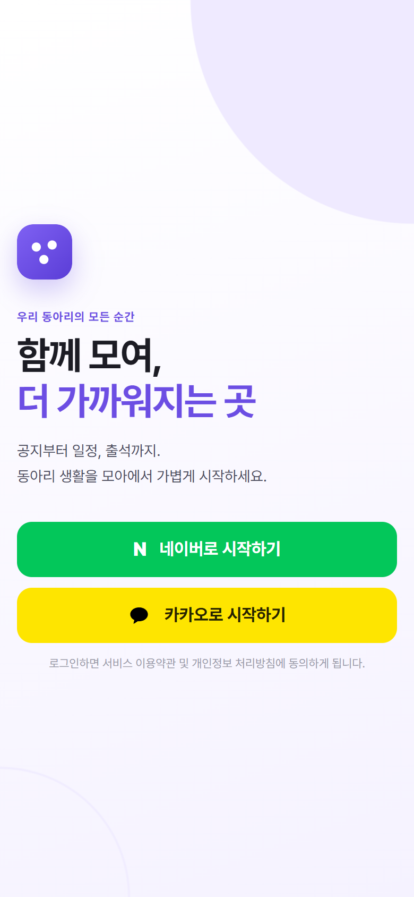 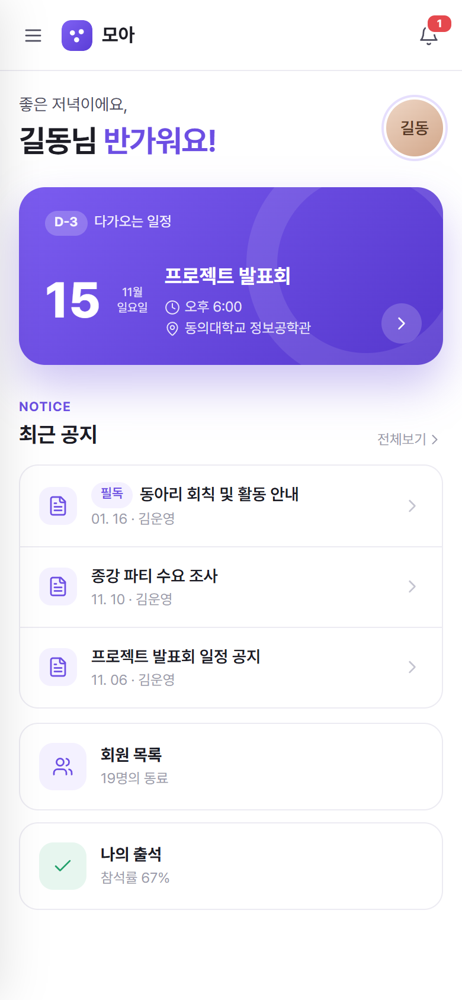 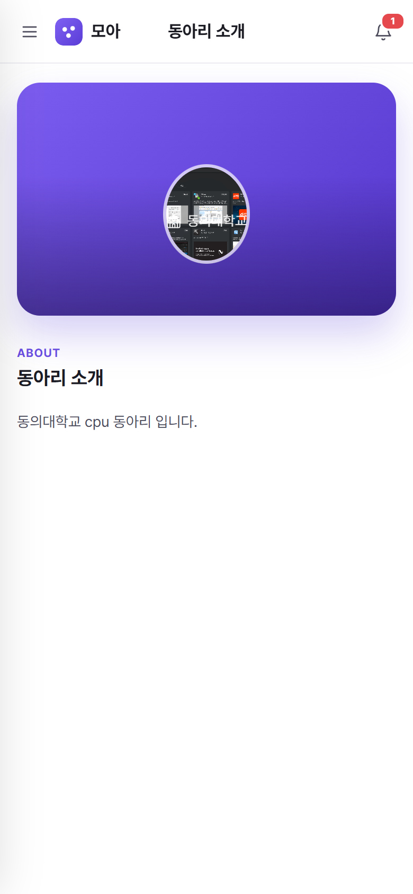

**[공지 목록 / 공지 상세 / AI 문장 다듬기]**

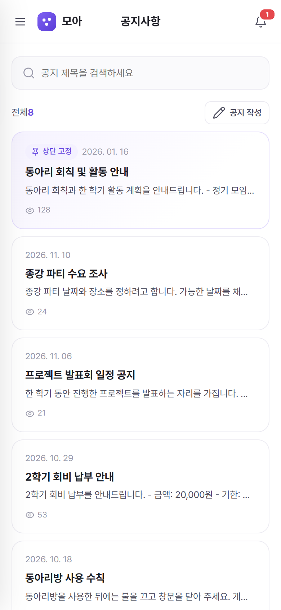 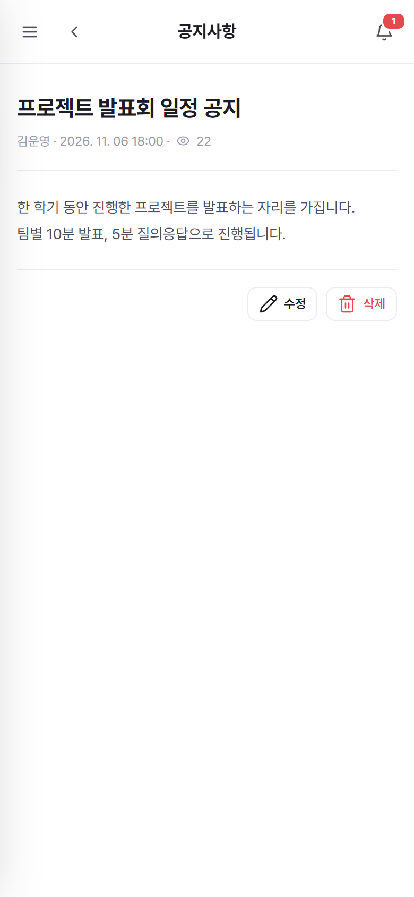 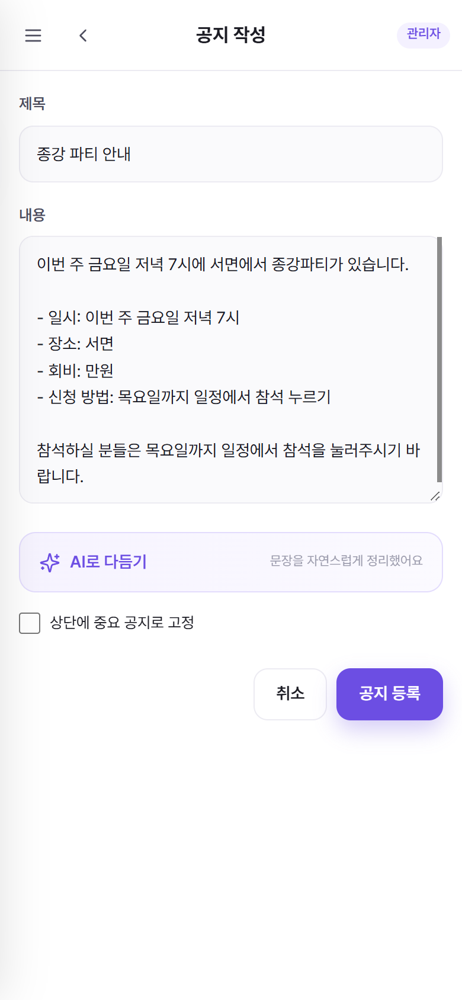

**[일정 목록 / 일정 상세 · 지도 / 참석자 명단 / 일정 등록 — 장소 검색]**

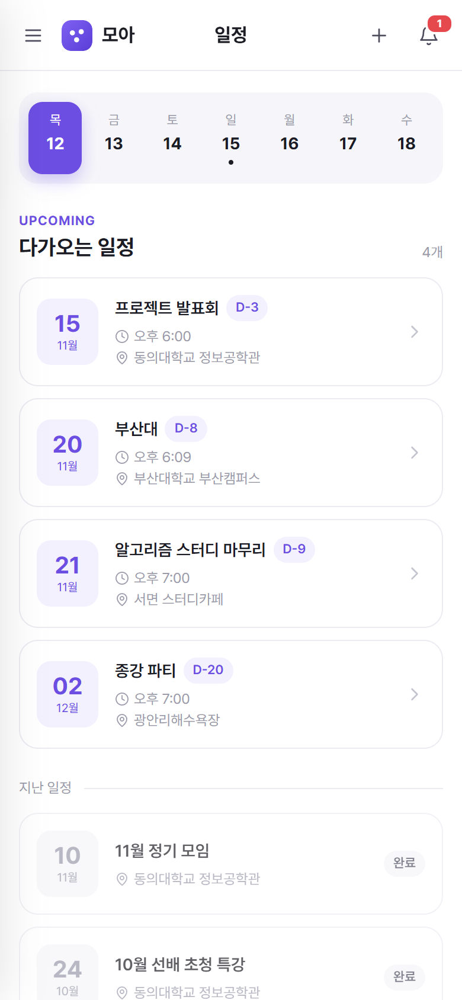 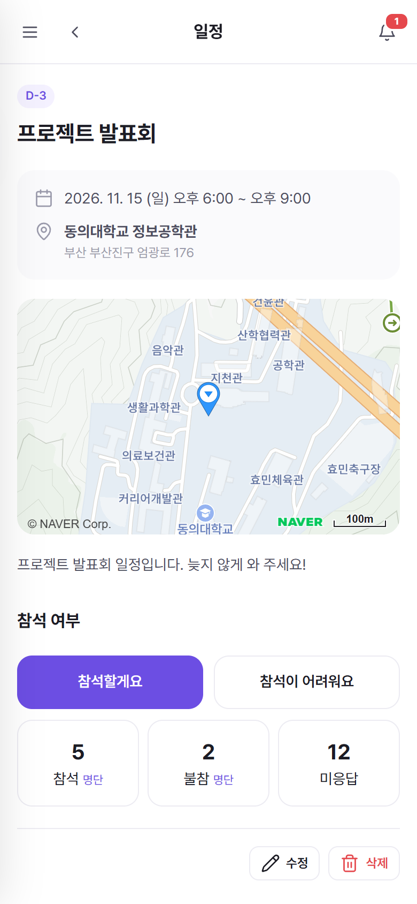 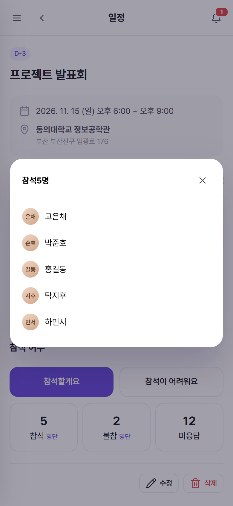 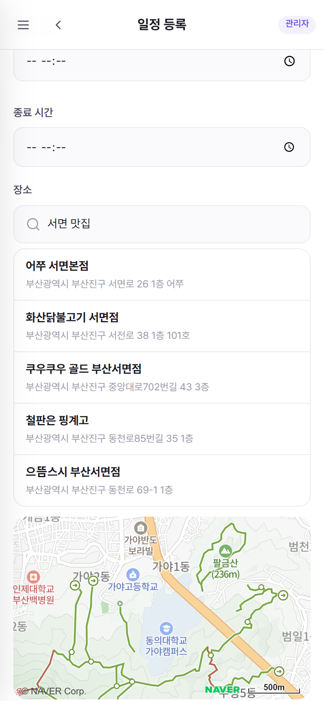

**[단체 채팅 / 내 정보 / 알림]**

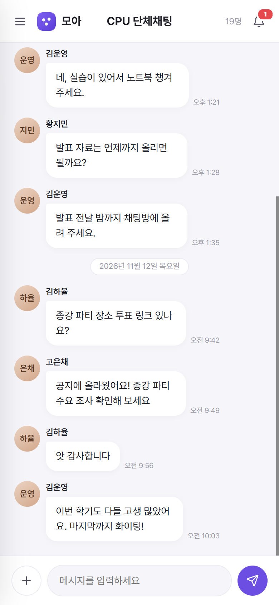 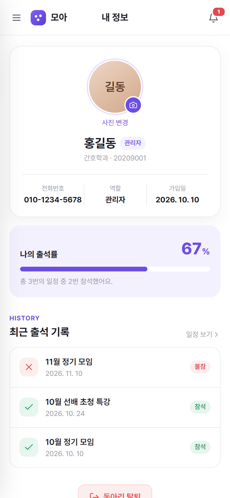 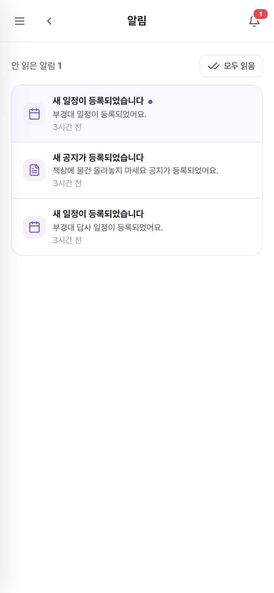

**[관리자 — 대시보드 / 가입 승인 / 회원 관리]**

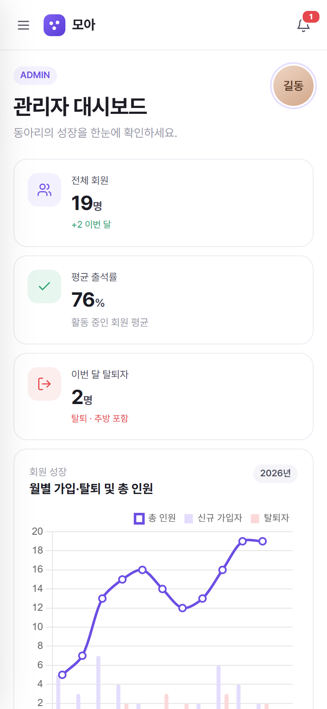 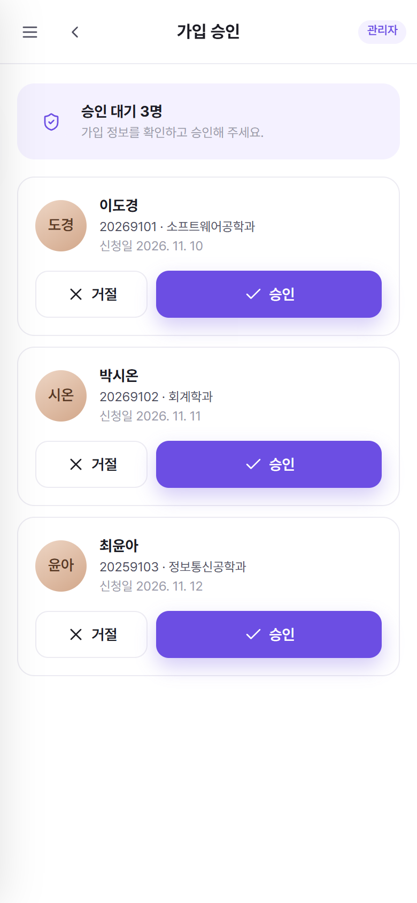 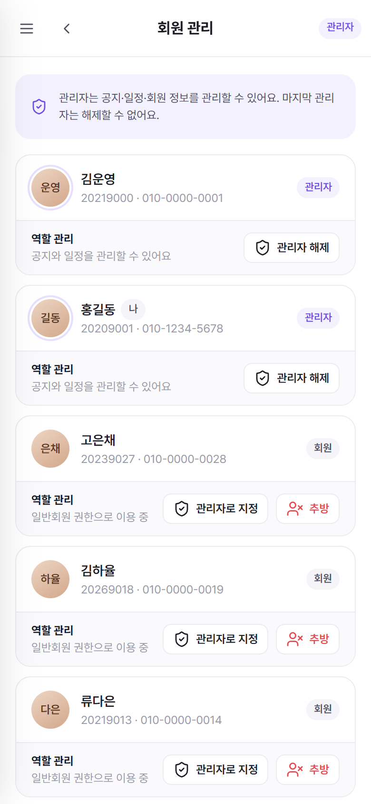

<br/>

## Getting Started (실행 가이드)

### 1. 준비물
* JDK 21 이상, Apache Tomcat 10.1, MariaDB(또는 MySQL)
* 네이버 · 카카오 개발자 앱, NCP Maps · API HUB 키, Gemini API 키, GA4 측정 ID (없으면 해당 기능만 동작하지 않음)

### 2. 설정 파일
`config.properties` 는 API 키 등 민감 정보를 담으므로 `.gitignore` 에 포함되어 있습니다. `config.example.properties` 를 복사해 **직접 생성**하고, 위치를 환경 변수 `CLUBAPP_CONFIG` 로 지정합니다. (기본값 `/var/clubapp/config.properties`)

```properties
db.url=jdbc:mysql://localhost:3306/clubapp?serverTimezone=Asia/Seoul&characterEncoding=UTF-8
db.user=clubapp
db.password=

upload.dir=/var/clubapp/uploads

naver.client.id=
naver.client.secret=
naver.callback.url=http://localhost:8080/login/naver/callback

kakao.client.id=
kakao.client.secret=
kakao.callback.url=http://localhost:8080/login/kakao/callback

naver.map.client.id=
naver.hub.client.id=
naver.hub.client.secret=

ga.measurement.id=
ai.api.key=
ai.model=
```

### 3. 데이터베이스
```bash
mysql -u root -p < db/schema.sql        # clubapp DB 생성
mysql -u root -p clubapp < db/demo-data.sql   # (선택) 시연용 더미 데이터
```
> 더미 회원은 소셜 계정이 없어 로그인할 수 없습니다. 본인 계정으로 가입 신청한 뒤 아래 SQL 로 관리자로 지정합니다.
> ```sql
> UPDATE member SET role='ADMIN', status='ACTIVE', approved_at=NOW() WHERE student_no='내 학번';
> ```

### 4. 업로드 폴더 연결
업로드 파일은 Tomcat 의 별도 컨텍스트로 제공합니다. `{Tomcat}/conf/Catalina/localhost/uploads.xml` 을 만들고 `upload.dir` 과 같은 경로를 지정합니다.

```xml
<Context docBase="/var/clubapp/uploads" />
```

### 5. 빌드 및 실행
```bash
# Windows
gradlew.bat war

# macOS / Linux
./gradlew war
```
> `build/libs/ROOT.war` 를 `{Tomcat}/webapps/` 에 복사한 뒤 Tomcat 을 실행합니다. 접속 확인: http://localhost:8080

(배포: EC2 배포 방법 작성 예정)

<br/>
